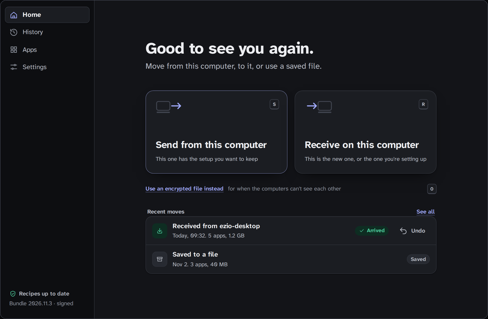
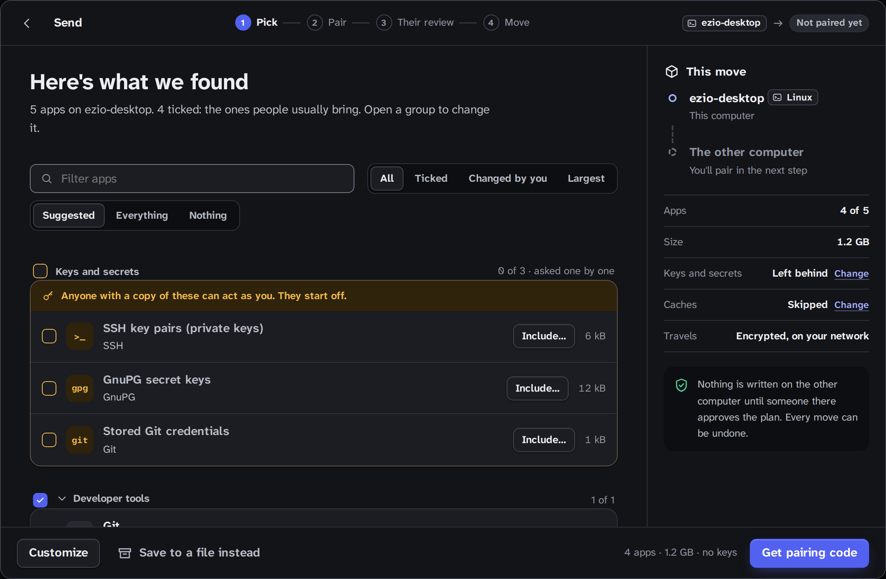
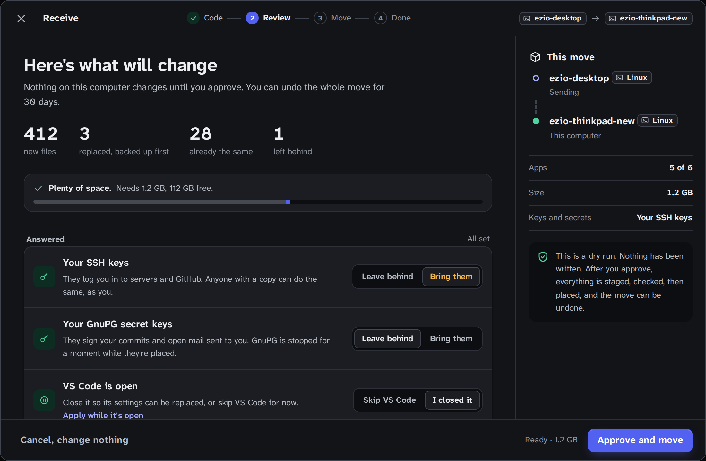
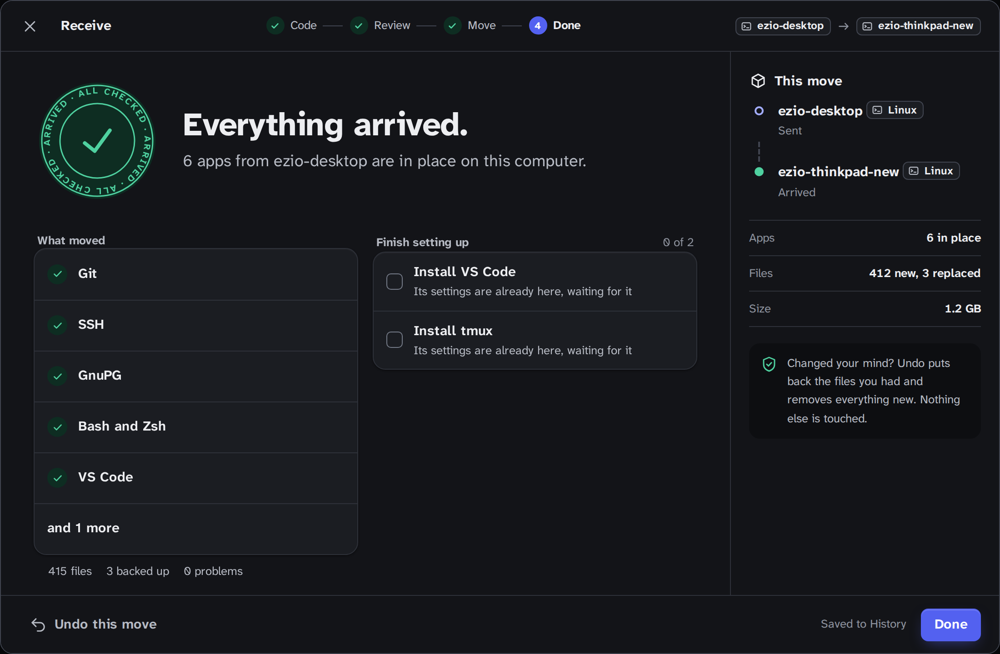

# Carrova

Move your app settings, keys and data to a new Linux computer over your local
network, or as an encrypted file. You pick exactly what moves. Apps themselves
are never copied: Carrova lists the ones to install, and their settings are
already waiting when you do.



## Why Carrova

- **You choose.** Carrova finds your apps and suggests what to bring. Change
  any of it. SSH keys, GPG secret keys and stored tokens stay off until you
  confirm each one.
- **Nothing changes until you approve.** The new computer shows a plan first:
  new files, replaced files (backed up), space needed.
- **Moves can be undone.** Files are staged, checked, then placed; undo puts
  back what was replaced (files you edited since the move are left alone).
- **Private by design.** Computers pair with a short code shown on both
  screens; everything travels end-to-end encrypted on your own network.
  No account, no cloud.
- **Resumes.** Sleep, Wi-Fi drops or a restart pick up where they left off.

| Pick what moves | Review the plan | Done |
|---|---|---|
|  |  |  |

## Install

Download from the [latest release](https://github.com/pratyush618/carrova/releases/latest)
(x86_64 and arm64).

| Distro | Package | Install |
|---|---|---|
| Ubuntu, Debian, Mint, Pop!_OS | `.deb` | `sudo apt install ./Carrova_*.deb` |
| Fedora / openSUSE | `.rpm` | `sudo dnf install ./Carrova-*.rpm` / `sudo zypper install ./Carrova-*.rpm` |
| Any distro | `.AppImage` | `chmod +x Carrova_*.AppImage && ./Carrova_*.AppImage` |

Needs glibc 2.35 or newer (Ubuntu 22.04+, Debian 12+). If the AppImage won't
start on Ubuntu 24.04+, install FUSE 2: `sudo apt install libfuse2t64`.

The AppImage offers new versions in the app and installs them when you agree;
`.deb`/`.rpm` update by installing the new package.

## Use

1. Open Carrova on both computers.
2. Old computer: **Send**, tick what to bring, **Get pairing code**.
3. New computer: **Receive**, type the code, review the plan, **Approve and move**.

No network between them? Choose **Use an encrypted file instead** and carry
the file on a USB stick.

### Command line

```sh
cargo install --git https://github.com/pratyush618/carrova carrova-cli

carrova scan                      # what Carrova found
carrova send                      # old computer: prints a pairing code
carrova receive                   # new computer: type the code, review, approve
carrova export -o move.carrova    # or an encrypted file…
carrova import move.carrova       # …restored on the other side
carrova rollback                  # undo the last move
```

The CLI and the desktop app run the same engine and behave identically.

## Supported apps

Git, GitHub CLI, SSH, GnuPG, Bash, Zsh, Fish, Starship, tmux, Vim, Neovim,
VS Code, Zed, Sublime Text, WezTerm, Cargo, npm, Docker and Obsidian.

Each app is a small data-only *recipe* (no code). Recipes ship as a signed
bundle and update without a new app release.
[Add one](CONTRIBUTING.md).

## Status

**v0.1:** Ubuntu → Ubuntu (other modern distros should work), for developers.
Windows and macOS are in progress.

## Build from source

```sh
just setup-ubuntu && just ui-install   # system libs + front-end deps
just build                             # engine + CLI
just tauri dev                         # desktop app
just ci                                # everything CI runs
```

See [CONTRIBUTING.md](CONTRIBUTING.md) and [SECURITY.md](SECURITY.md).

## License

[Apache-2.0](LICENSE)
